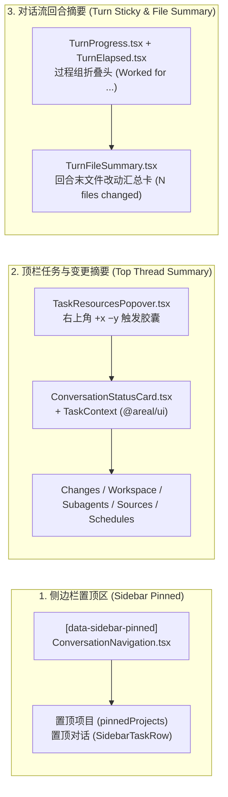

# Codex 设计系统深度调研与 AReaL GUI 全模块优化方案

本报告基于外部调研包 `/Users/sailfish/Documents/deepseek-harness/default-workspace/codex-design/`（Codex Electron `v26.313.41514` 静态逆向提取：`00-README.md`、`01-设计令牌全表.md`、`02-界面架构拆解.md`、`03-主题系统深度报告.md`），对照 AReaL GUI 现行设计系统（`clients/gui/packages/ui/tokens.json`、`clients/gui/packages/ui/src/theme.ts`、`clients/gui/renderer/src/styles.css`、`clients/gui/renderer/src/workbench.css` 及 `@areal/ui` 组件库），给出三阶段演进蓝图与**七大核心页面模块（设置、首页、工作台、Side Panel、Composer、对话流内容、Pin Summary）**的完整覆盖矩阵。

本文件作为研究证据与实施规划归档，遵循 `R-ENTRY-006`（Codex 为桌面视觉与交互第一参考，不复制品牌或越过本仓执行与权限边界）。正式规则与 Token 变更实施时，按 `clients/gui/design-system/rule-maintenance.md` 同步更新所属唯一所有者。

---

## 一、核心差距诊断：为什么当前 GUI 已有 Token 仍与 Codex 质感有差距？

AReaL 目前已经具备 `@areal/ui`（`tokens.json` -> `generate-tokens.mjs` -> `tokens.css`）的单源生成链路，但与 Codex 桌面版相比，存在以下 5 个结构性差距：

| 维度 | Codex 设计系统机制（调研发现） | AReaL GUI 现状 | 核心差距与影响 |
| --- | --- | --- | --- |
| **1. 颜色派生与感知混色** | 仅维护极少基础色（`bg`、`fg`、`accent`、`semantic`），其余近百个表面、描边、悬停、徽章全部通过 `color-mix(in oklab, var(--color-text) X%, transparent)` 与 `color-mix(in oklab, var(--bg) 92%, var(--fg))` 动态派生。 | `tokens.json` 硬编码静态 Hex/RGBA（如 `#f7f7f8`、`rgba(13, 13, 13, 0.04)`），`theme.ts` 通过 JS RGB 线性插值计算仅 9 个 CSS 变量，且 `literal-baseline.json` 仍豁免 `workbench.css`（77 处）与 `SettingsWorkspace.css`（26 处）等硬编码颜色。 | 换肤或暗色微调时，次级容器、卡片边框、悬浮态不能自动随底色感知共鸣，局部硬编码导致暗色/高对比度下层次断裂。 |
| **2. 玻璃材质与浮层（Liquid Glass）** | 建立三级模糊变量（`--blur-menu: 16px`、`--blur-header: 18px`、`--blur-popover: 24px`）与液态玻璃表面（`--color-bg-glass` + `backdrop-filter: blur(...) saturate(1.2)` + `1px` 内高光描边 + 多层柔和阴影 `--shadow-menu` / `--shadow-dialog`）。 | `tokens.json` 仅有单一 `shadow.surface`（`0 10px 28px ...`），无 `blur` 令牌，菜单、Popover 与顶栏主要依赖纯色背景（`--color-menu`）和单层实线边框。 | 弹出菜单、命令面板、Pin Summary（任务上下文弹窗）与吸顶栏缺少桌面原生的通透纵深感与边缘精致度。 |
| **3. 几何圆角与容器嵌套规律** | 9 档完整圆角阶梯（`2xs: 2px` -> `xs: 4px` -> `sm: 6px` -> `md: 8px` -> `lg: 10px` -> `xl: 12px` -> `2xl: 16px` -> `3xl: 20px` -> `4xl: 24px`），严格遵循 `R_outer = R_inner + Padding` 同心圆角公式（如 Composer 外框 `24px`，内部胶囊按钮 `9999px` 或 `12px`）。 | `tokens.json` 仅有 5 个圆角角色（`status-dot: 999px`、`inline-code: 5px`、`control: 8px`、`inset: 10px`、`panel: 12px`）；而 `workbench.css` 中 Composer 写死 `20px`、多处卡片写死 `6px`/`14px`/`16px`。 | 大容器（Composer、首页引导卡、Dialog、Pin Summary 弹窗）与内嵌子控件圆角比例未对齐，缺少视觉韵律。 |
| **4. 布局契约与阅读视口几何** | 全局布局由根级契约变量驱动：`--spacing: 4px` 原子网格、`--height-toolbar: 46px`、`--width-sidebar: clamp(240px, ..., 520px)`、`--thread-content-max-width: 768px`、`--home-composer-top: calc(42svh - ...)`、`--thread-summary-panel-available-height`。 | 壳层尺寸分散在 `workbench-shell.css`（`292px`、`46px`）与 `workbench.css` 各处局部选择器中，缺乏统一的线程流最大阅读宽度与响应式内边距公式。 | 宽屏下对话流、工具组、代码块与底部 Composer 的左右对齐边界及呼吸感不如 Codex 严谨。 |
| **5. 物理弹簧曲线与分层微动效** | 区分语义缓动：`--cubic-enter: cubic-bezier(0.19, 1, 0.22, 1)`、`--Transition-Spring-Fast`（`linear(...)` 物理弹簧采样）、折叠面板 `grid-template-rows: 0fr -> 1fr`、生成态流光渐变与浮动导航刻度轨（`--marker-progress`）。 | `tokens.json` 仅有 `fast: 120ms`、`normal: 180ms` 与单一 `standard: cubic-bezier(0.2, 0, 0, 1)`，部分过渡散落在 `workbench.css`（`200ms`/`300ms`）。 | 侧栏开合、过程组折叠、Popover 弹出与思考中状态缺乏细腻的阻尼感。 |

---

## 二、七大核心模块全覆盖映射表（Phase 1 ~ Phase 3）

若将三个阶段全部做完，**设置、首页、工作台、Side Panel、Composer、对话流内容、Pin Summary** 七大模块将实现 **100% 全覆盖**。下表列出每个模块涉及的真实源码文件、Codex 对标机制以及在本方案三阶段中的具体落地内容：

| 模块名称 | AReaL 对应源码与组件资产 | 对标 Codex 核心设计机制 | Phase 1（基础层：Token 与 OKLab 主题引擎） | Phase 2（壳层与核心交互表面重构） | Phase 3（状态微动效、字面量清零与门禁闭环） |
| --- | --- | --- | --- | --- | --- |
| **1. 设置（Settings）** | `clients/gui/renderer/src/settings/SettingsWorkspace.tsx` `SettingsPageParts.tsx` `DisplaySettings.tsx` `PluginCenter.tsx` `WorktreesSettings.tsx` `UsageDashboard.tsx` `@areal/ui/src/settings/*`（`settings-page`、`settings-group-card`、`settings-row`、`settings-select`、`settings-segmented-tabs`、`settings-navigation`） | 左导航 + 右侧限宽分组卡片（`SettingsGroupCard`）；OKLab 92%/88% 表面阶梯；`1px` 极淡内分隔线（`border-subtlest`）；20 套预设主题与 `accent`/`contrast` 实时预览。 | 为设置卡片提供 `surface-elevated` / `surface-tertiary` 派生表面与 `border-subtlest` 分隔线 Token；在 `DisplaySettings.tsx` 升级 `theme.ts` 的 OKLab + Contrast 实时派生引擎。 | 统一设置导航栏（`settings-navigation`）与主区顶栏 `46px` 高度契约；统一 `SettingsGroupCard` 圆角（`radius-xl: 12px`）、行高与分段控制器（`settings-segmented-tabs`）的 `surface-control` 材质。 | 彻底清零 `SettingsWorkspace.css`（26 处）、`usage.css`（10 处）、`trajectory-settings.css`（8 处）中的硬编码颜色与圆角字面量，并同步更新 `literal-baseline.json`。 |
| **2. 首页（Home / Draft View）** | `clients/gui/renderer/src/ConversationDraftEmptyState.tsx` `views/ConversationWorkspace.tsx`（`DraftConversation`） `DraftComposer.tsx` `ProjectlessDraft.tsx` `WorktreeStarter.tsx` `renderer/index.html`（`.startup-screen`） | `[data-composer-placement="home"]` 黄金视觉重心（`--home-composer-top: max(0px, calc(42svh / var(--codex-window-zoom) - var(--app-shell-main-content-top-offset)))`）；居中迎宾标题 + 项目/Worktree 胶囊引导 + 大圆角 Composer。 | 注入 `--home-composer-top`、`--thread-content-max-width: 768px` 与首页大标题字阶（`--text-heading-lg` 紧凑负字距 `-0.02em`）；同步 `index.html` 启动屏与主主题底色无缝衔接。 | 重构 `ConversationDraftEmptyState.tsx`、`DraftConversation` 与 `WorktreeStarter.tsx` 的垂直重心与水平限宽，使首页草稿 Composer、项目切换栏（`.composer-project-bar`）与快速启动卡片形成同心圆角与视觉聚焦。 | 首页向活跃对话态（`home -> thread`）切换时的 Composer 位移与列表入场过渡采用 `--cubic-enter` 与 `prefers-reduced-motion` 双轨适配。 |
| **3. 工作台（Workbench Shell & Sidebar）** | `clients/gui/renderer/src/app-shell/WorkbenchShell.tsx` `views/WorkbenchChrome.tsx`（`WorkbenchRail`、`WorkspaceNavigation`、`ConversationHeader`） `views/ConversationNavigation.tsx` `@areal/ui/src/workbench/workbench-shell/*` `@areal/ui/src/workbench/task-list-item/*` | 46px 顶栏（`--height-toolbar`）与 macOS 红绿灯安全区（`--padding-left-header`）；侧栏沉降底色（`--bg-sidebar` = 94% bg + 6% fg）；28px~32px 高密度任务行（`--radius-md: 8px`）；拖拽分割线微发光热区。 | 定义 `--height-toolbar: 46px`、`--width-sidebar`、`--color-sidebar`（OKLab 沉降底色）与状态点语义色（running/completed/warning/danger）。 | 升级 `WorkbenchShell`、`ConversationHeader` 与 `ConversationNavigation`：顶栏毛玻璃渐变遮罩（`--blur-header`）、任务行选中/悬停态（`color-mix` 5%/8% 透明度）、分组折叠头与新建任务按钮组。 | 侧栏展开/收起与宽度拖拽采用弹簧阻尼曲线（`--Transition-Spring-Fast`），清理 `workbench.css` 中壳层相关的硬编码像素与颜色。 |
| **4. Side Panel（右侧检查面板与伴随窗）** | `clients/gui/renderer/src/app-shell/SidePane.tsx` `SidePaneTabOverview.tsx` `SideChatPane.tsx` `AgentConversationPane.tsx` `@areal/ui/src/workbench/side-pane-frame/*` `@areal/ui/src/workbench/side-pane-launcher/*` Files / Diff / Review / Browser / Terminal 面板 | 独立 Inspector 表面层级（`--bg-panel`）、紧凑型单行胶囊标签栏（Tab strip）、Diff 行级语法表面色（`--color-diff-add-bg` / `del-bg` 基于 OKLab 12%~15% 混合）、内嵌 SideChat 紧凑 Composer。 | 补齐 Diff 增删背景/行号/高亮表面 Token、面板级次级背景 `--color-surface-elevated` 与紧凑间距 Token。 | 统一 `SidePaneFrame`、`SidePane.tsx` 顶部标签栏、工具栏按钮尺寸（`28px` 紧凑控件）、`SideChatPane` / `AgentConversationPane` 的紧凑对话流密度，以及 Files/Diff/Browser/Terminal 四大面板的边框与空状态视觉。 | 优化 `SidePane` 开合、Tab 切换及 `SidePaneTabOverview` 网格视图的过渡体验，消除面板内部硬编码色值。 |
| **5. Composer（主输入台与草稿输入台）** | `@areal/ui/src/conversation/composer-surface/*` `@areal/ui/src/conversation/composer-toolbar/*` `@areal/ui/src/conversation/attachment-card/*` `clients/gui/renderer/src/Composer.tsx` `prompt-editor/ChatPromptEditor.tsx` `ComposerModelMenu.tsx` `ComposerAttachments.tsx` | 24px 大圆角外框（`--radius-4xl`）+ 1px 12% 透明描边 + 聚焦发光环（`focus-ring`）+ 多层柔和浮起阴影；内部双层结构（ProseMirror 编辑区 + 36px 底部胶囊工具栏）；紧凑态（SideChat `compact`）自适应降级为 `16px` 圆角。 | 新增 `--radius-composer: 24px`（紧凑态 `16px`）、`--shadow-composer`、`--color-focus-ring`、菜单级 `--blur-popover: 24px` 与 `--shadow-menu`。 | 重构 `composer-surface.css`（替换现行写死的 `20px` 圆角与单层阴影）、统一底部 `ComposerToolbar` 胶囊触发器、`ComposerModelMenu` 浮层玻璃材质，以及 `AttachmentCard` / 折叠文本卡 / 目录引用胶囊的同心圆角（`10px`/`8px`）。 | 打磨附件准备/上传/失败状态徽章、语音/发送/停止圆形主按钮的按压反馈（`scale(0.97)`）与运行中状态呼吸动效。 |
| **6. 对话流内容（Conversation Timeline）** | `clients/gui/renderer/src/Messages.tsx` `TurnExecution.tsx` `ToolEvent.tsx` `@areal/ui/src/conversation/activity-group/*` `activity-row/*` `thinking-status/*` `decision-card/*` & `question-card/*` `command-details/*` `markdown-surface/*` & `markdown-table/*` `message-code-block/*` | 768px 居中阅读列；用户消息右对齐胶囊（`--radius-2xl: 16px` + `surface-secondary`）；助手流式 Markdown 无背景直出；工具调用树采用 `60%`/`30%` 文本透明度层级与左轨竖线；代码块双层嵌套容器（外层 `surface-secondary` 含语言栏 + 内层 `surface` 代码区）；底部渐隐遮罩（`--conversation-fade`）。 | 建立过程树层级色彩 Token（`--agent-activity-summary-color: color-mix(in oklab, var(--color-foreground) 60%, transparent)`、`--agent-activity-child-color: 30%`）、代码块双层表面与表格斑马纹 Token。 | 升级 `Messages.tsx`、`ActivityGroup`、`ActivityRow`、`CommandDetails`、`MessageCodeBlock`、`MarkdownTable` 与 `DecisionCard` / `QuestionCard`（审批与提问卡采用 `surface-elevated` + 左侧语义强调边框），对齐 768px 阅读列与行距节奏。 | 引入思考态/执行中文字流光动画（Shimmer text，受 `prefers-reduced-motion` 控制）、过程组 `0fr -> 1fr` 展开过渡，以及长对话右侧浮动快速定位刻度轨（Floating Navigation Rail）探索。 |
| **7. Pin Summary（置顶与任务上下文/变更摘要体系）** | **① 顶栏任务资源与变更摘要弹窗**： `views/TaskResourcesPopover.tsx`、`ConversationStatusCard.tsx`、`@areal/ui/src/conversation/task-context/*` **② 回合内过程摘要头与文件变更汇总卡**： `TurnProgress.tsx`、`TurnElapsed.tsx`、`TurnFileSummary.tsx` **③ 侧栏置顶区（Pinned Section）**： `views/ConversationNavigation.tsx`（`[data-sidebar-pinned]`） | **① 顶栏 Summary Popover**：右上角 `+x -y` Diff 统计胶囊按钮 + `--thread-summary-panel-available-height` 限高玻璃浮层（Changes / Workspace / Subagents / Sources 分组摘要）； **② 回合 Sticky Summary & File Summary**：回合过程折叠摘要头（`Worked for Xm Xs`）在长回合滚动时支持吸顶（`--thread-sticky-header-top`），回合末尾 `TurnFileSummary` 汇总本轮修改文件并提供一键打开 Diff Review； **③ Sidebar Pinned**：置顶项目与置顶任务独立分组与拖拽热区。 | 新增 `--thread-summary-panel-available-height`、`--thread-sticky-header-top`、Diff 增删数字语义色（`--color-diff-add-fg` / `--color-diff-del-fg`）及 Popover 玻璃阴影 Token。 | **全面升级三类 Pin Summary**： 1) **`TaskResourcesPopover` + `TaskContext`**：触发器升级为 Codex 风格紧凑 `+add / -del` 胶囊，弹出层采用 `--blur-popover` + `--shadow-menu` + 分组紧凑列表； 2) **`TurnProgress` + `TurnFileSummary`**：优化回合过程摘要头与横线分隔比例，升级本轮文件修改汇总卡（`TurnFileSummary`）的展开列表与 `+x -y` 徽章对齐； 3) **`[data-sidebar-pinned]`**：优化侧栏置顶分组标题、拖拽落点指示线与置顶任务行状态标识。 | 为 `TurnProgress` 摘要头增加长回合滚动吸顶（Sticky Header）平滑衔接，为 `TaskResourcesPopover` 展开/收起与 `TurnFileSummary` 折叠面板接入物理弹簧过渡，消除 `AgentResources.css` 与 `task-context.css` 的样式断层。 |

---

## 三、专门针对「Pin Summary」模块的深度设计拆解

在 AReaL 与 Codex 的工作台架构中，**Pin Summary（置顶与摘要体系）** 承担着“在不打断主对话阅读流的前提下，随时掌控全局上下文、代码改动与关键任务”的核心职责，具体包含三个相互配合的子面：

### 3.1 顶栏任务资源与变更摘要弹窗（`TaskResourcesPopover` + `ConversationStatusCard` + `TaskContext`）
- **现状痛点**：
  - [`TaskResourcesPopover.tsx`](file:///Users/sailfish/CodeProject/AReaL-Harness/.worktrees/one-protocol-rust/clients/gui/renderer/src/views/TaskResourcesPopover.tsx) 触发器与右侧图标按钮排列较松散，`+add −del` 计数徽章缺少 Codex 的胶囊底色与等宽数字对齐（`font-variant-numeric: tabular-nums`）。
  - [`task-context.css`](file:///Users/sailfish/CodeProject/AReaL-Harness/.worktrees/one-protocol-rust/clients/gui/packages/ui/src/conversation/task-context/task-context.css) 使用纯色 `background: var(--color-menu)` 与普通 `1px` 实线边框，缺少最大可用高度约束变量与毛玻璃浮层质感。
- **Codex 对标优化方案**：
  1. **触发器胶囊化**：当 `changed === true` 时，`task-resources-trigger.with-count` 采用 `height: 28px`、`border-radius: var(--radius-control)`（`8px`）、`background: var(--color-surface-elevated)`，内部 `+add`（`var(--color-success)`）与 `−del`（`var(--color-danger)`）强制 `tabular-nums` 与 `12px` 字号。
  2. **浮层容器升级**：`task-resources-popup` 与 `.areal-task-context` 接入 `max-height: var(--thread-summary-panel-available-height, calc(100svh - var(--height-toolbar) - 24px))`、`backdrop-filter: blur(var(--blur-popover)) saturate(1.2)`、`box-shadow: var(--shadow-menu)` 与 `border-radius: var(--radius-panel)`（`12px`）。
  3. **四维摘要分区高密度化**：统一 `ConversationStatusCard` 内 **工作区与环境（Workspace & Git Branch）**、**文件改动（Changes）**、**子代理与后台进程（Subagents & Processes）**、**引用源与定时任务（Sources & Schedules）** 的行高（`32px` 紧凑行）、悬停高亮（`--color-hover`）与右侧快捷跳转箭头。

### 3.2 对话流内的回合摘要头（`TurnProgress`）与文件变更汇总卡（`TurnFileSummary`）
- **现状痛点**：
  - [`TurnProgress.tsx`](file:///Users/sailfish/CodeProject/AReaL-Harness/.worktrees/one-protocol-rust/clients/gui/renderer/src/TurnProgress.tsx) 的过程摘要头（`本轮过程` / `Worked for ...`）在展开长工具调用链时滚出视口，用户难以得知当前所处回合或快速收起该回合。
  - [`TurnFileSummary.tsx`](file:///Users/sailfish/CodeProject/AReaL-Harness/.worktrees/one-protocol-rust/clients/gui/renderer/src/TurnFileSummary.tsx) 在回合底部展示已验证写入文件列表与 `+x −y` 统计，但卡片圆角、文件目录前缀弱化（dirname 60% 透明度 + basename 100% 前景色）与一键跳往 `改动` 面板的交互反馈还可进一步向 Codex 的 Turn Diff Summary Card 靠拢。
- **Codex 对标优化方案**：
  1. **过程摘要头吸顶（Sticky Turn Summary Header）**：在 `Messages.tsx` 阅读视口内引入 `--thread-sticky-header-top: 0px`，使展开状态的 `.turn-progress-heading` 支持局部 `position: sticky; top: var(--thread-sticky-header-top); z-index: 2`，配合底部渐隐遮罩，方便在长执行过程中随时一键收起（同时严格保持 `Messages.tsx` 的阅读锚点不变，遵循 `progressAutoCollapse` 契约）。
  2. **回合末文件改动汇总卡（`TurnFileSummary`）精致化**：
     - 外框采用 `--radius-inset`（`10px`）+ `--color-surface-elevated` 背景 + `1px solid var(--color-border-subtle)`；
     - 头部汇总行展示文件图标、修改文件数、总计 `+add −del`（`tabular-nums`）与右侧 `查看改动 (Review)` 胶囊按钮；
     - 展开文件列表每行采用 `30px` 紧凑高度，路径拆分为弱化目录前缀（`color: var(--color-foreground-subtle)`）与高亮文件名（`color: var(--color-foreground)`），点击直达 `SidePane` 对应文件或 Diff 位置。

### 3.3 侧边栏置顶区（Sidebar Pinned Section）
- **现状痛点**：
  - [`ConversationNavigation.tsx`](file:///Users/sailfish/CodeProject/AReaL-Harness/.worktrees/one-protocol-rust/clients/gui/renderer/src/views/ConversationNavigation.tsx) 中的 `[data-sidebar-pinned]` 包含置顶项目（`pinnedProjects`）与置顶对话（`visibleRows.filter(r => r.pinned)`），但置顶区与下方普通项目区缺少微妙的视觉层级区分。
- **Codex 对标优化方案**：
  - 统一 `[data-sidebar-pinned]` 分组头的 `11px` 小字紧凑标签与折叠箭头过渡；
  - 置顶任务行（`SidebarTaskRow` / `TaskListItem`）在悬停与激活态下提供清晰的图钉（Pin）操作入口、后台执行状态圆点（Running 脉冲点 / 未读圆点）以及拖拽排序时的 2px 品牌色插入指示线。

---

## 四、三阶段实施路线图（Roadmap）

### Phase 1：设计令牌（Tokens）与 OKLab 主题派生引擎升级（地基阶段）
1. **扩充 `clients/gui/packages/ui/tokens.json` 与 `generate-tokens.mjs`**：
   - **圆角阶梯**：新增/对齐 `2xs (2px)`、`xs (4px)`、`sm (6px)`、`md (8px)`、`lg (10px)`、`xl (12px)`、`2xl (16px)`、`3xl (20px)`、`4xl (24px)`，并将原有角色令牌（`--radius-control`、`--radius-inset`、`--radius-panel`、`--radius-composer`）映射到该阶梯。
   - **模糊与多级阴影**：新增 `--blur-menu (16px)`、`--blur-header (18px)`、`--blur-popover (24px)`，以及 `--shadow-control`、`--shadow-menu`、`--shadow-composer`、`--shadow-dialog`。
   - **布局与视口契约变量**：新增 `--height-toolbar (46px)`、`--thread-content-max-width (768px)`、`--home-composer-top`、`--thread-summary-panel-available-height`、`--thread-sticky-header-top`。
   - **缓动曲线**：新增 `--ease-enter: cubic-bezier(0.19, 1, 0.22, 1)` 与 `--ease-spring-fast`。
2. **升级 `clients/gui/packages/ui/src/theme.ts` 与 `clients/gui/renderer/src/styles.css`**：
   - 将静态次级表面与透明描边升级为原生 CSS `color-mix(in oklab, ...)` 表达式（保留 `tokens.json` 静态回退值以通过契约校验）；
   - 引入 `--agent-activity-summary-color`（60% 文本混合）与 `--agent-activity-child-color`（30% 文本混合）；
   - 在 `DisplaySettings.tsx` 中支持基于 `contrast` 参数的动态对比度调节。

### Phase 2：七大页面模块视觉与组件合同对齐（全模块覆盖阶段）
1. **工作台壳层（Workbench Shell）+ 侧栏置顶区（Pin Summary ③）**：
   - 更新 `workbench-shell.css`、`WorkbenchChrome.tsx`、`ConversationNavigation.tsx`、`task-list-item.css`。
2. **首页（Home / Draft View）+ Composer（主/草稿/紧凑输入台）**：
   - 更新 `ConversationDraftEmptyState.tsx`、`ConversationWorkspace.tsx`、`composer-surface.css`、`ComposerToolbar`、`ComposerModelMenu.tsx`、`AttachmentCard`。
3. **对话流内容（Conversation Timeline）+ 回合内 Pin Summary（② `TurnProgress` & `TurnFileSummary`）**：
   - 更新 `Messages.tsx`、`TurnProgress.tsx`、`TurnFileSummary.tsx`、`activity-group.css`、`activity-row.css`、`message-code-block.css`、`markdown-table.css`、`decision-card.css`。
4. **顶栏 Pin Summary（① `TaskResourcesPopover` & `TaskContext`）+ Side Panel（`SidePane`）**：
   - 更新 `TaskResourcesPopover.tsx`、`ConversationStatusCard.tsx`、`task-context.css`、`SidePane.tsx`、`side-pane-frame.css`、`SideChatPane.tsx`。
5. **设置（Settings）**：
   - 更新 `SettingsWorkspace.tsx`、`SettingsWorkspace.css`、`DisplaySettings.tsx` 及 `@areal/ui/src/settings/*` 组件样式。

### Phase 3：状态微动效、字面量清零与门禁验收（打磨与收口阶段）
1. **状态微动效接入**：
   - 接入思考态流光文字（Shimmer）、过程组平滑折叠、Composer 主按钮按压缩放与 `prefers-reduced-motion: reduce` 完整降级。
2. **CSS 字面量清零与 Baseline 收紧**：
   - 逐步清零 `workbench.css`、`SettingsWorkspace.css`、`usage.css`、`trajectory-settings.css` 中的硬编码颜色与像素字面量，缩减 `clients/gui/design-system/literal-baseline.json`。
3. **全套自动化门禁与亮暗双主题真机验收**：
   - 执行 `pnpm --dir clients/gui --filter @areal/ui generate && build && check`；
   - 执行 `pnpm --dir clients/gui verify:design`、`typecheck`、`test:design`；
   - 按照 `areal-ui-critique` 与 `verify-areal-harness` 技能，在亮色（Light）与暗色（Dark）双主题下对**设置、首页、工作台、Side Panel、Composer、对话流内容、Pin Summary** 逐一取证验收。
