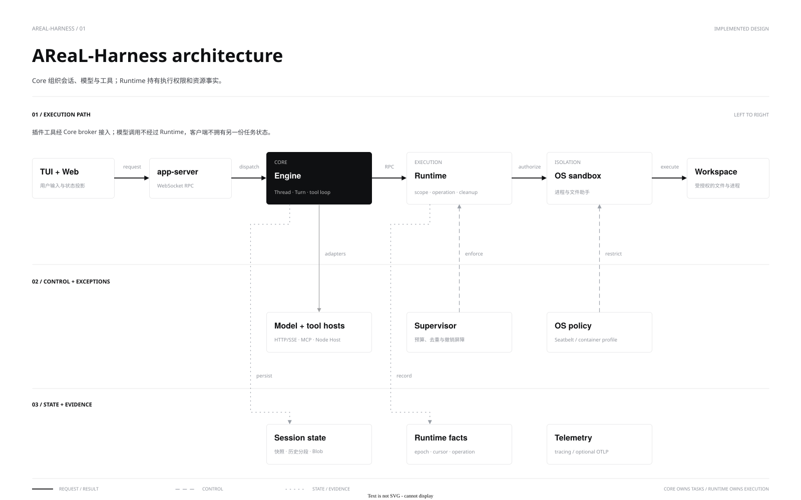

[中文](architecture.md) | **English**

# Architecture and repository

AReaL-Harness follows **Clients → Core → Runtime**. Core exclusively owns sessions, Turns, model loops and agent state. Runtime handles execution permissions, operation facts and resource lifecycles. Clients project the authoritative history rather than maintaining another one.



[draw.io source](diagrams/architecture.drawio) · [PNG](diagrams/architecture.png) · [Diagram style](STYLE_GUIDE.en.md)

Renderer language belongs to existing application preferences and accepts zh-CN and en. React Intl derives copy, numbers and dates from bundled messages without changing Core state, configuration or conversation identity. Retained local notices keep message descriptors and raw arguments until render; raw diagnostics and third-party content stay verbatim. See the [GUI language contract](../../clients/gui/README.en.md#interface-language-and-copy-development).

GUI Renderer reads the preload object only in `main.tsx`. `createDesktopServices` injects the existing `PlatformServices` into the application. MCP Apps, native resource selection, and icon loading receive their capabilities through this interface. Missing capabilities do not create desktop subscriptions or native resource entry points. React components do not read the global bridge separately. Main continues to validate IPC senders and own windows, App tokens, and native grants. Core and Runtime retain execution and history authority.

Core owns cross-restart creation admission evidence in the existing submissions journal. It persists admission before creation side effects and binds requests to journal coverage and the Engine boot. Only a retired original instance, continuous journal coverage, and absence of both admission and a Thread creation receipt establish non-admission. Desktop persists that result before removing pending; Renderer retains the draft. Legacy records, missing coverage, and admitted but unsettled records remain UNKNOWN without automatic replay. Retention, migration, and crash windows are specified in the [submission contract](../api/desktop.en.md#submissions).

## Responsibilities

| Module | Responsibility |
|---|---|
| `clients/cli`, `clients/tui`, `clients/web` | CLI, terminal and local Web; connection setup, projections and requests |
| `clients/gui` | React/Electron desktop client; narrow IPC, native resources, public service discovery and rebuildable projections |
| `clients/mobile` | Capacitor iOS/Android Remote client; reuse the GUI mobile entry, shared Remote protocol and conversation components, with native Keychain, Android Keystore, scanning and lifecycle adapters; see the [iOS development guide](../development/ios-development.en.md) for capabilities and acceptance boundaries |
| `core/config` | User configuration, provenance, credential references, Skill directories and the tool-host proxy environment allowlist; no Engine/Runtime dependency |
| `core/protocol` | Client protocol projections and shared types |
| `core/engine` | Models, tools, history, persistence, child tasks and Workgroups |
| `core/app-server` | WebSocket, authentication, subscriptions and callback correlation; no separate history |
| `core/local-service` | Shared discovery, configuration compatibility and control client; depends on config/protocol |
| `core/service-host` | Rust trusted launcher and independent local service host; manages Core/Runtime lifecycles and private pipes |
| `core/server` | Configuration, models, MCP, Hosts, Runtime and shutdown assembly |
| `core/plugins` | Codex-compatible package parsing, local marketplaces, digest caches and installation/activation transactions; never executes package code |
| `core/mcp` | Official rmcp client and result adaptation; no Turn ownership |
| `core/sdk-typescript` | Selected DSH tools/filesystem adaptation and independent Node Host |
| `runtime/protocol`, `runtime/client` | Independent execution contract and Rust private-pipe client |
| `runtime/supervisor` | Scopes, narrowing permissions, ancestor budgets, deduplication and cleanup |
| `runtime/host-tools` | Trusted host tool discovery shared by Core and the native backend; no task execution or permission grants |
| `runtime/exec-native`, `runtime/fs-helper` | OS sandbox, processes/PTYs and descriptor-based file operations |
| `runtime/daemon` | Binary, Cordis assembly and private RPC |
| `runtime/sdk-typescript` | Low-level Node.js SDK for a trusted host with an exclusive connection |

`supervisor` depends on `protocol`; `exec-native` implements its backend interface; the daemon assembles them. Engine does not depend on app-server or clients. Server resolves and injects configuration; SDKs do not discover user configuration themselves.

Engine's `catalog` module maintains in-memory UUID and creation-order indexes, updated together during registration and rollback. They hold session handles and immutable sort keys; dynamic metadata still comes from current session state. Queries project only the current page. Authorized IDs intersect the indexes first. Desktop views share typed Core filters: dormant entries prefilter compact fields while loaded sessions inspect current state. Arbitrary Rust predicates still inspect candidate projections. The directory lock is released before waiting for session locks.

Memory is the default backend. The `sqlite` mode persistently indexes only immutable `(id,created_at)` keys, using one bounded batch writer and two reader threads with WAL. Queries resolve keys to current sessions under the same generation. Lag falls back to memory; errors or writer queue overflow disable SQLite for the instance. Memory indexes remain available for fallback, and startup checks every index key. Eager modes fully recover files. `store::lazy` supplies rebuildable metadata caches using a JSON manifest or SQLite; after fact-identity validation, `dormant` holds compact directory state, restoring history, tool bindings and event windows on first use. `memory-lazy` and `sqlite-lazy` both query memory order indexes directly; the latter persists metadata in SQLite to reduce whole-manifest JSON encoding, decoding and rewriting. Complex ownership and unsettled execution retain original full recovery; caches do not determine execution facts. All modes still enumerate files. Automatic history eviction and full-text search are not implemented. File records retain authority and recovery responsibility, with unchanged write ordering, durability and state version. See [session catalog backends](../guides/configuration.en.md#session-catalog-backends) for configuration and the [Core API](../api/core.en.md#transport-and-sessions) for interface boundaries.

Linux `exec-native` starts a separate Rust binary provided by the same crate, `areal-runtime-reaper`, for each execution. It becomes a subreaper and owns waiting for and reaping the command and adopted descendants. Runtime waits for the helper and validates its private exit/cleanup receipt. The helper ships with the daemon and file helper in `libexec/areal` and does not require Python. macOS supplements process-group cleanup with `libproc` tracking and termination of observed descendants. These responsibilities stay outside the Core model loop and do not replace an outer service manager or container init; see the [Runtime cleanup contract](../api/runtime.en.md#output-and-cleanup) for platform differences and limits.

Engine's `session_name` module owns one-shot asynchronous session naming, durable claims and current-state merges. It reuses shared model capacity and shutdown lifecycle. Clients only project Core names and local manual overrides; they do not schedule naming inference. See the [Core session-name contract](../api/core.en.md#session-names) for fields and failure boundaries.

Engine's `execution_trace` module saves measured activity timing in existing Turn history. Read-only queries reuse history pagination and delegation ownership; the trusted Workgroup factory reads bound isolated-worker history without acquiring a second Store writer. GUI owns query presentation and copying. Local inspection is independent of export settings. See the [Core API](../api/core.en.md#local-execution-trace-inspection) for fields, compatibility, and original-result boundaries.

Engine’s `trajectory` module records model and tool execution content through `tracing`; server’s `telemetry` module assembles the standard OpenTelemetry Traces/Logs SDK and OTLP exporters. Engine does not read telemetry environment variables or depend on an export backend; see [reporting configuration](../guides/configuration.en.md#opentelemetry-trajectory-reporting).

Server injects a shared Engine capture budget when installing telemetry. Engine uses borrowed serialization and bounded streaming buffers for logical messages and final model requests; exhaustion drops only the telemetry copy. The durable event bridge owns Turn sequences and terminal manifests so receivers can distinguish completed execution from complete delivery. See the [Core trajectory contract](../api/core.en.md#durable-trajectory-protocol).

Optional persistent trajectory export uses `[trajectory]` parsed by `core/config`. `core/server/trajectory` owns bounded memory buffering, the disk queue, and an independent upload process. Queues default to the user home and are isolated by configuration-file identity, with services and owned CLI runs sharing the queue of their configuration; network uploads are outside Turn settlement and Runtime lifecycles. CLI/TUI use a cancellable background check for a single warning; GUI polls according to visibility. Clients inspect export status and use public Core controls to enable, disable, or retry uploads. Receivers accept standard OTLP Logs; platform analysis registration belongs to receiver integrations. See [persistent trajectory export](../guides/configuration.en.md#persistent-trajectory-export) for configuration, capacity, and failure boundaries.

Skill discovery in `core/config` uses trusted launch parameters and returns metadata with individual warnings. Engine also reuses its stateless header parser for explicit deployment registration, without locating user configuration itself. `core/engine/src/desktop/skills.rs` retains registered directory descriptors and asynchronously reads bounded pages of current resources without Skill content snapshots. See the [Skill guide](../guides/skills.en.md) for configuration and read contracts.

Codex-compatible packages use `core/plugins` for local installation and scoped selection. Engine registers immutable plugin Skill roots, freezes references when admitting a Turn, and checks current revocation on resource reads. Ordinary sessions discover new installations; explicit Profiles, legacy read-only Side sessions and isolated workers gain no automatic authority. Onboarding uses the existing ordinary Turn entry and clients recover UNKNOWN through existing management receipts. Standalone Skills retain their dynamic descriptor-based read contract. See the [plugin guide](../guides/plugins.en.md) for supported behavior and the [implementation plan](../development/codex-plugins-plan.en.md) for full compatibility.

The same package parser owns component support reports. Candidate reports bind `admissionDigest ?? sourceDigest`. Installed reports bind `installedDigest`. Store combines current enablement intent with static compatibility of the exact package digest. Historical Skills are checked against their own immutable packages, and Engine admits exact id/revision references. Hook declarations and Apps documents reuse their parsing owners. Reports execute no package code; authentication, connection and trust retain their existing runtime owners.

Offline plugin reads reuse `core/plugins::Store::read_snapshot`. Before starting a project, Main invokes the bundled CLI as a short-lived process with trusted configuration-home and registered-workspace inputs. Renderer receives only static projections with scope, revision, and observation time. The corresponding Core still owns runtime observations. Commands enter ordinary submission with installed-digest references. Agents become immutable Profiles with provenance. Store retains ordinary configuration values and secret references; Engine resolves secrets at connection time. Shared configuration does not inject new secrets into other running Cores. Development changes produce new installation snapshots. Existing Turns retain their content, and new MCP/Hook trust is checked against the new digest. Trusted discovery sources refresh standalone Skill metadata for the next Turn of an automatically discovered Profile. Explicit Profiles retain their selections.

### Multiple plugin formats

Import each supported format and version into AReaL components, then use the existing execution owners. New packages should use the Agent Plugins 1.0.0 Skills and MCP structure. Compatibility importers interpret Codex, Claude, Cursor, and ZCode discovery order, default directories, marketplace merging, and extension rules. Recognizing a manifest does not establish support for all behavior of its original host. An unknown Portable schema does not fall back to another format.

Imported declarations retain package identity, component names, source locations, and required semantics. `core/plugins` owns package discovery and effective definitions. `core/mcp` owns MCP configuration validation, authentication, and connections. Support reports, previews, and execution share declaration interpretation. Management APIs expose only redacted projections. A source format grants no Hook, tool, network, or file permission. Optional component failures stay within their boundaries. Unsatisfied required components or package requirements block effective activation.

For the first MCP slice, the existing `core/mcp` library owns document interpretation. `core/plugins` depends on that library and retains declarations with their source locations. Accept the larger package-tool compilation dependency in exchange for one interpretation entry, the existing MCP call interface, and existing per-server validation. This dependency grants package discovery no network or process authority and stores no connection state in Store.

`PluginDeclaration` privately retains the original input, envelope location, and delayed validation error. It exposes safe envelope projections and normalized configurations. `McpComponentDocument` retains the declaration source. Claude last-definition selection precedes server-count checks and scans of retained document references. The raw JSON entry also uses the same declaration interpretation. Full runtime validation does not change static installation admission prematurely.

Distinguish format recognition, component semantics, current availability, and real-path validation. The current static MCP report promises only `areal-mcp-document-envelope-v1`. It does not establish valid runtime configuration, authentication, or connectivity. Configuration owners retain user values and secret references. Plugin dependencies belong to the installation graph, separate from MCP connection state.

This design concentrates source differences and reuses existing authority. Separate ecosystem runtimes would duplicate authorization, cancellation, and recovery. A universal JSON representation would erase override and execution semantics. Neither alternative is adopted. Preserve original packages, source and admission digests, Store transactions, Turn versions, revocation, and UNKNOWN non-replay. Future importer changes that alter execution meaning must define renewed review and retained-reference behavior instead of inheriting trust silently. See the [staged implementation plan](../development/codex-plugins-plan.en.md#multiple-format-imports).

Source resolution remains with `core/plugins`; Git/npm install scripts never run. `core/mcp` owns authentication, resources and connection generations, while Engine freezes Turn schemas/callables and owns revocation, admission and cleanup. Apps bind a Core process epoch, Thread and package digest; Electron sandboxes receive narrow capabilities. Main records each App instance’s original window owner and retains its live iframe during ordinary navigation. Disposal and revocation use that recorded ownership without requiring a live native window. Asynchronous open results recheck owner and epoch, and old tokens never transfer to the active window. Actual file I/O reuses Runtime directory-descriptor helpers, and model projection strips `_meta`. Original Connector IDs map explicitly to GitHub; credentials enter only through a trusted launch environment.

The interactive entry for a successful MCP result submits only its original Thread, Turn, Core item and opening request identity. Core verifies raw snapshot integrity and provenance captured by the original call, then prepares resources through the original connection without repeating the business tool. One Manager commits result operations and App instances together. Closed facts outlive live pages, and old process-epoch requests cannot reopen them. Main reuses tokens by original window and Core instance; Workspace retains the iframe. Missing provenance, changed digests, revocation and page failures preserve the ordinary readable result.

Finite page tools use the ordinary Core tool inventory, approval, and ToolCall history. Registration declares fixed selection reads and revision-checked edits. Core freezes the original ToolHost, App epoch, package digest, and registration. Desktop binds the opening Main socket; Main binds the window, token, and initialized bridge. A notice only wakes the original executor. A durable claim grants execution once. Each invocation owns claim and settlement writes. Later hooks or generic finalization cannot replace an accepted terminal record. Connection loss revokes execution while retaining the unsaved page. UNKNOWN never replays automatically. See the [desktop contract](../api/desktop.en.md#finite-page-tools) for protocol and budgets.

Generated interactive answers reuse the MCP Apps page host without creating a plugin or another sandbox. Core's native `gen_ui_publish` tool publishes immutable HTML artifacts. `areal/genUi/source` resolves their provenance from a completed assistant message. Main uses the ported ZCode directive parser to match each `::visualize` reference against Core's artifact list. A Renderer-supplied file path cannot open arbitrary HTML. Generated pages share window tokens, the resource proxy, and the eight-page limit with MCP Apps.

Core owns execution, history, and HTML provenance. Desktop owns view state in the current user profile. The ported `packages/gen-ui` storage isolates state by project, Thread, and artifact path, and atomically saves `{modelContent,privateContent}`. Each entry is limited to 16 KiB, with up to 100 entries per conversation. Ordinary main and Side submissions append only bounded `modelContent` as untrusted context to the next input. `privateContent` never enters model requests. State can be restored within the same Desktop profile, without cross-device synchronization. Generated pages have no Node, file, tool, or network access. Generated pages do not change host-session permissions; legacy read-only Side sessions retain their read-only policy.

Plugin downloads and preparation run outside the Engine directory refresh lock. Store's cross-process lock and revision CAS own commit; a directory from one installation-state snapshot is then published under the refresh lock, with connection draining outside it. Typed MCP cleanup failures enter `cleanupUnknown` and cannot reconnect as ordinary failures; a subsequent disconnect without a cleanup handle cannot clear that state. Shared enablement and instance-local reviewed definitions remain separate: hook calls read current enablement, and background reconciliation cancels in-flight hooks from disabled packages, including old invocations whose definitions were removed by an update. A frozen Turn version does not freeze authority. Explicit Profiles exclude plugins by default; deployment-defined `allowPluginSkills` opts in while children retain the parent plugin boundary. Hook roles and matchers use the admitted Profile identity, including child ownership during compaction. State polling reads installation state without enumerating packages. Parsed components are cached by package identity, digest and policy; each use checks file/directory identity, permissions, size and mtime/ctime through NOFOLLOW descriptors, and changes require full digest validation. MCP calls validate only their own package. This cache adds no isolation guarantee against arbitrary concurrent directory replacement by the same UID.

MRTR runs in `core/mcp` through modern discovery and negotiation; Engine binds the logical call, per-round authorization and cancellation. Opaque requestState never enters Renderer. Main owns native selection; Core validates field/generation ownership and delegates bounded NOFOLLOW descriptor snapshots to Runtime, returning opaque resource URIs. Auth configuration stores secure-vault references; challenges and exact sent-token rejection remain private to MCP connections. App subscriptions share first-subscribe/last-unsubscribe by instance, URI and generation, with close and notification dispatch using one lifecycle boundary.

`core/engine/src/goals` owns persistent Goals, request ledgers and continuation across Turns. User queues and automatic continuation share one admission entry point. Clients maintain projections and Runtime retains its execution boundary. See the [Core API](../api/core.en.md#goals).

Interactive TUI and Web launchers attach to one service per deployment. The host survives windows while Store retains its exclusive writer lock. Desktop Main can reuse the same discovery/control entry point; see [local services](../api/local-service.en.md).

Core lifecycle assessment separates idle-stop admission from execution settlement after cancellation. Desktop adds only its own connection and in-flight operation guards. A shared lifecycle entry in trusted Main handles observation, confirmation scope and original-instance exit checks for startup recovery, updates and menu stop. The cancel intent reaches the public service host while Queue input remains durable. Partial stops and unknown responses remain recovery states rather than inferred global rollbacks. See the [Desktop API](../api/desktop.en.md).

`core/engine/src/task_mode` owns Tasks/TaskRuns, time triggers, independent Channels and workers. It reuses Goal ledgers and Thread admission; communication state belongs to Core. Inbox projects authorized questions. TaskRun workers survive coordinator Turns in independent Sessions while Core owns cancellation and settlement. See the [Task contract](../api/tasks.en.md).

Manual Run Now reuses Task atomic commits, total budgets and the queued Run execution path. Core persists the Run, objective snapshot and receipt before Host preparation. Clients recover through a read-only query of the original receipt without changing the schedule or replaying unknown submissions.

Task persistence has one commit point, the v6 `desktop/task-mode.json` root. This compact catalog references immutable hot Tasks, per-Task history chains, and compressed radix receipt/provenance indexes with fixed bucket heads. Index depth is bounded by the 256-bit key width. Terminal leaves hold at most 64 rows and ordinarily pack within 128 KiB; valid large single rows retain the 256 MiB hard limit. Controls avoid history scans and publish only changed Tasks, original receipts, and the root. Live retention checks are bounded, and history that cannot be confirmed safe remains hot. Cold Run usage and counts commit with the same root; archiving never turns an old Goal into an ordinary Goal. Full Task and history reads retain snapshot-based authorization and projection. Trusted Desktop directory reads use the last successfully published bounded view without waiting for the Task writer or cloning its complete Snapshot. Files synchronize before the root is atomically replaced and its directory synchronized. An unknown outcome freezes writes until restart validates and synchronizes all reachable references. Versions 1 through 5 retain their original root bytes and referenced immutable files before migration. Version 6 prevents older binaries from ignoring the summary contract. Migration does not infer state from orphans.

Core owns the trusted local task-catalog preview. It reads one atomic root and its immutable schedule summary pack without opening Store or restoring execution. Summaries, Tasks, receipts, and ownership indexes commit through that same root without a separate mutable index. Version 5 retains its trusted reader for upgrade display and enabled-schedule discovery, followed by atomic migration when Core legitimately starts. Published data establishes neither live execution nor unknown submission outcomes and cannot supply control revisions. Desktop keeps one directory cache and watch per execution owner for the task center, source sidebar, and notifications. Gaps, generation changes, and backpressure retain previous display data and rebuild the baseline. The existing shared Desktop backend coordinates activation separately. Core retains trigger, misfire, and overlap admission authority. App exit stops scheduling. Explicit stops suppress automatic activation; window closing retains existing background behavior. See the [local service API](../api/local-service.en.md#published-task-catalog-preview) and [Task API](../api/tasks.en.md#bounded-directory-and-owner-updates).

Ordinary writable desktop conversations create and manage schedules through Core scheduled_task_* tools. Core binds the current registered Host identity and connection, source Thread, and cwd while retaining frozen permissions and tool allowlists. sourceThreadId records provenance, threadId remains a separate execution anchor, and each Run creates another Thread. Durable tool-call identity supplies write keys, receipt inspection preserves UNKNOWN, and stale revisions cannot silently overwrite changes. The deletedAt tombstone reuses cancellation and stop settlement, preserving history, receipts, and capacity usage. Durable chat cards, Thread resources, and the global center read the same Task. New independent tasks use ordinary conversation tools without Renderer polling to confirm saves.

Historical task-draft management reuses ordinary Messages and Composer, reusing TaskResourcesPopover and extending ConversationStatusCard with description and status summaries rather than a fixed side pane. Host task-draft interprets Agent proposals and validates saves in one management Thread; Core history stays intact and the UI reads a decoded display projection. Creation and per-turn edit receipts prevent duplicate processing; renderer permission controls cannot lift management execution restrictions. Creation automatically prepares an independent directory and management Thread through ProjectlessWorkspaces. Existing Tasks retain their ownership, and Host and Core validate directory boundaries. Management and execution Threads remain separate, and the execution anchor inherits the management Thread cwd. Proposal digests bind the original structured time intent. Core replays the original receipt before resolving a new submission against one captured clock value. One Core calculator validates, previews and advances calendar rules and fixed intervals; Host only formats their display. Legacy intervals retain their exact seconds and cursor. Calendar rules resolve missing dates and DST in the saved zone. The latest trigger decision commits atomically with the cursor, and new Runs retain accepted rules so later edits cannot rewrite their rule, objective or preparation. Proposal and control success states require matching host receipts. A scheduled Task uses its anchor Thread to locate the execution environment; each Run creates a fresh conversation with frozen configuration. Core owns triggering, offline catch-up and busy skips; an authenticated desktop Host supplies configuration/tools through prepare/ready. Pause affects future triggers, Run controls stop/resume execution, and approval expiry retains blocked work.


[draw.io source](diagrams/task-mode-mailbox-architecture.drawio) · [Asynchronous interaction flow](diagrams/task-mode-mailbox-flow.svg) · [Flow source](diagrams/task-mode-mailbox-flow.drawio)

`clients/cli` provides the Rust command executable, `areal`, dispatching to library entry points for TUI, noninteractive execution, Core server and the service host. Core never depends on clients. The Rust launcher in `core/service-host` owns separate Core/Runtime processes and private lifetime pipes without Python on Linux; on macOS, `/usr/bin/python3` is the actual launching parent of the trusted service-host, launcher, Core and Runtime processes to accommodate local executable launch constraints. `core/local-service/native_process` only adapts service-chain process identity, explicit descriptors and lifecycles; it does not make Runtime sandbox or permission decisions. `scripts/launch.py` remains available for development scripts and independent benchmark entry points. The bundle exposes only `areal` in `bin`; Runtime daemon/file helpers live in `libexec/areal` and are not linked into the client process. See the [client guide](../guides/clients.en.md) for commands.

Historical evidence records a direct Rust launch receiving SIGKILL, success through Python, and a later successful direct launch. The signal sender remains unknown. These observations do not establish AMFI, TCC, quarantine, or a security product as the cause. The GUI prerequisite check validates selected developer tools and system Python before starting a new backend. It does not change parent identity, descriptors, signals, exit receipts, or Runtime permissions.

macOS Runtime also bundles standalone Bash as a private shell resource for restricted commands and resolves system Git to its actual toolchain path before sandboxing. These adaptations address tool startup and temporary-directory compatibility without changing the Core task loop or Scope isolation. See the [Runtime contract](../api/runtime.en.md#system-tools-in-restricted-macos-commands) for assets, third-party licensing and boundaries.

## State and execution

GUI first presentation and backend readiness are separate decisions. Once the theme and icon loading view can paint, Renderer notifies Main through the existing narrow IPC. Main combines that signal with native paint readiness and consumes automatic presentation once. Closing the window cancels pending automatic presentation, so later recovery cannot reopen or focus it. Backend, project, and selected conversation restoration continue through the existing observation path. Until initial restoration succeeds, only the icon and loading status appear. The home page, sidebar, new-conversation, and Projectless preparation controls remain unmounted. Success mounts the complete workbench at once. Failures stay in the loading view and recover through existing owners. Execution remains subject to connection, conversation restoration, and Core admission. Restoration failures preserve the selection and draft and use existing retry, backend details, and quit paths.

Renderer owners in `state/` manage startup, navigation, workspace, tasks, appearance, and notices. Domain stores subscribe through `useSyncExternalStore`; existing preference keys and persistence owners remain authoritative. `App.tsx` retains effects that coordinate reads and writes across domains. Stores do not replay Core receipts, history, or UNKNOWN operations. View composition belongs to `app-shell/`, Electron preview adapters to `app/src/core/preview-native/`, and Electron-independent URL, coordinate, observation, and planning logic to `preview/`. Existing Main owners retain window, WebContentsView, and background focus lifecycles.

The GUI Desktop service and Main encode rebuildable state through `workbench/client/state-projection`. Each connection starts with a baseline of the current display window, then sends changes and order by Project, Thread, Turn, and Item identity. Unchanged bodies are omitted. Main encodes only filtered desktop state. Renderer reconstructs display snapshots after contextBridge. A missing baseline or sequence gap triggers a state read without resubmitting execution requests. A Core supporting bounded history supplies a recent window through `areal/thread/observe`; older history and oversized items use pages and fragments. Renderer automatically reads one page only after upward reading input, retains a button for retry and keyboard access, and restores the reading anchor after merging. Desktop caches at most four older page bodies per window; evicted pages retain only lightweight cursors within the current snapshot and appear as reloadable gaps in their original positions. Reloading uses the same body-cache limit. Re-observation or stale cursors rebuild the window and its gaps. The display window is not another complete authoritative history. A changed Item notification still replaces the whole Item; see the [Core history contract](../api/core.en.md) for record-parsing and active-item growth limits.

Renderer document reload or crash does not own the backend execution lifetime. After an explicit reload, the new document attaches to the original application session from a new projection baseline without replaying accepted input. `test:service-reopen` proves attachment through new fragments on the original model connection and their display in the production App. It distinguishes document recovery from the new owner and generations created by an application restart.

Changes within a Thread are serialized; different Threads progress concurrently. Model, tool and child-task waits do not retain the session lock. Model permits are released during tool execution. Active Turns, model requests and OS processes have separate limits.

Tools persist intent before dispatch to Runtime or an external host, then record confirmed outcomes. Snapshots retain authoritative history; media and large original tool results are stored as SHA-256-addressed Blobs; owning Thread call records authorize result references, and initial tool views are generated once and persisted with history; explicitly enabled experimental observation projections affect requests without rewriting authoritative history. Restart marks unfinished execution UNKNOWN without replay. Archiving releases hot history; GC after drain reclaims unreferenced Blobs.

Engine `context` and `history` modules plan complete model requests and validate compaction candidates before Store commits them atomically. Clients display budgets and compaction outcomes. See [context management](context-management.en.md) for allocation and failure rules.

The Workgroup `handoff` module projects committed checkpoint and final reports from isolated workers using the shared provenance and pagination contract. Execution, cleanup, verification and delivery retain their existing owners. Trusted deployment toolchain discovery belongs to runtime/host-tools; Runtime enforces read-only software-resource access independently of task content. See the [Runtime contract](../api/runtime.en.md#system-tools-in-restricted-macos-commands).

Ordinary [agent delegation](multi-agent.en.md) shares a workspace with independent context; [Workgroups](workgroups.en.md) use isolated writable workspaces and verified artifacts. Core schedules; Runtime does not select width. Plugins, stdio MCP and Core remain trusted hosts. Broker restrictions do not sandbox the Host itself; see [plugin boundaries](plugins.en.md).

Optional [research agents](../guides/tools.en.md#research-agents) use Core-managed read-only source access, private scratch and shared budgets. Dispatch is asynchronous by default and model-selected. Short-handle caches belong to the active Turn, survive compaction and expire on completion; Store retains original execution history. The model HTTP layer audits redacted parameters and usage; incomplete-response recovery does not replay executed tools. See [Core API](../api/core.en.md#recovery).

Subscription forwarding retains only bounded, volatile account/Thread/Turn routing affinity using trusted Core request ownership. Routing state never enters model history or owns recovery or tool scheduling.

`core/engine/src/model/tool_calls.rs` centralizes request-level tool buffer budgets and sanitized diagnostics. Engine supplies execution allowances; model adapters bound resource use while accumulating responses. Automatic lossless media compression belongs to modality preprocessing with separate round-trip verification. The current tool buffer budget counts original UTF-8 bytes and does not trigger media compression.

Engine’s `diagnostics` module bounds non-authoritative diagnostic retention; server wires startup and periodic collection. service-host manages leases and cleanup for host/launcher logs and handshake temporary directories. Diagnostic cleanup preserves history and Goal recovery semantics; policies are described in [Core API](../api/core.en.md#recovery) and the [local service contract](../api/local-service.en.md).

Fork and Side reuse Core/Runtime session, history, and execution owners. `conversation.origin` records content provenance without agent delegation or cancellation ownership. Fork branches conversation history in the current shared workspace. New Side persists version 2 and `sideExecutableV2`, inherits current source configuration, and reuses ordinary submission, tools, permissions, and compaction. Stable source history is model-only. An active source Turn contributes only user input; child display and execution ledgers start empty. Legacy `sideReadOnlyV1` remains read-only in Store validation, tool catalogs, instructions, and Runtime Scopes. Renderer mounts full `Composer` and `Messages` per child, with project/parent/child identity for transient tabs, drafts, and references. Core owns creation and close receipts. Close establishes a durable admission fence before stopping and settling resources; UNKNOWN never replays. Hiding the panel and switching the parent preserve live children. Closing a tab releases its child, and restart restores no new tabs. Escape routes by pane DOM ownership. See the [Desktop API](../api/desktop.en.md#side-chat). Source, deterministic local models, real providers, and packages require separate verification.

Desktop directory admission verifies the Core-owned V2 source and matching physical cwd, mapping the Side and its delegated children to the source Session author; atomic first input uses the same admission. Files and browser results route through the child execution Core/root. The first Turn inherits only the fixed computer tool definition already attached to the source; legacy Side gains no permissions.

Prompt prediction reuses both Composers. Only a displayed GUI with the setting enabled requests a candidate for the latest successful turn. Core retains that turn's actual model instance and makes an independent, tool-free `promptPrediction` request. One persisted tagged `DesktopState.promptPrediction` slot owns source identity, deduplication, recovery and invalidation. A dedicated notification updates only that slot; Thread snapshots own recovery. Pending attempts cannot retry after restart; ready candidates restore verbatim. Prediction creates no Turn or Item and never enters Solve context. Lexical renders it outside the real document, and bare Tab only accepts it into the draft. Typing temporarily hides the stored candidate. Core owns model capacity, cancellation and final publication checks; the GUI owns preferences, demand and presentation. See [Core API](../api/core.en.md#next-prompt-prediction).

Ordinary Shared Browser loading uses Chromium system proxy, DNS, and site policies. Main isolates active control ports and exposes no product bridge to pages. The adapter binds a new user send to its exact Turn and GUI connection; the first Core-approved discovery lazily binds the current native Page without stealing a host through `thread/resume`. Main fences page reads and actions before dispatching human keyboard or mouse input, drains pending synthetic input, then delivers the first human event. Core read and action permissions bind the Page, control generation, and concrete plan; UNKNOWN is never replayed. See the [Browser contract](../api/browser.en.md) for the flow and limits.

Finite browser actions remain with the Main native preview owner. Observations retain separate viewport and native OPTION identities, and preparation and execution revalidate the same target. State waits read native facts without input. Scroll/hover observation invalidation preserves the confirmed batch prefix and call deduplication. Fixed native selection semantics expose no arbitrary script entry.

[Remote v2](remote-control.en.md) assigns the Gateway to the existing desktop background adapter and limits the browser to restricted projections; Core and Runtime retain execution and history ownership. Direct and Relay share the RemoteControl-owned session acceptor, observers and authorization budgets; transport adapters provide only bytes, liveness and backpressure. Direct uses a separate low-privilege listener, and Relay owns only routing and registration metadata. Neither forwards privileged local interfaces. See the [Remote API](../api/remote-control.en.md) for contracts and implementation status and [Host ownership](../adr/0008-remote-host-ownership.en.md) for the decision.

The Remote React Workbench directly reuses desktop `Messages`, `ConversationComposer`, model/permission menus, `ComposerQueue`, and `GoalCard`. The browser controller retains pairing, generations, drafts, and commandId reconciliation. Authorized Core overview supplies projects/Sessions; bounded atomic subscriptions supply detail. `session.control` accepts only model/permission, goal, and text queue intents, validated by Gateway and dispatched through the existing journal. It exposes no generic Core RPC or credentials. Ordinary Session enqueue uses Core atomic ownership/configuration admission; execution and history remain authoritative in Core.

Client design rules and page patterns live in [`clients/gui/design-system/`](../../clients/gui/design-system/README.md). The private workspace package [`@areal/ui`](../../clients/gui/packages/ui/README.en.md) owns the first adopted foundations, pure palette derivation and controls, plus pure Composer surface/toolbar and settings page/section/group/row layouts. Editors, submission, navigation guards and configuration saving retain their original host owners. Remaining controls, named themes, preferences and development previews retain their renderer owners. The rules directory owns neither business execution nor a second editable value source. See [D-004](../../design/decisions/004-local-ui-package.md) for the bounded migration. The [design-system architecture](../../clients/gui/design-system/architecture.md) defines admission for architecture, Base, independent exercises and feedback; package builds and catalog generation do not establish complete Base or visual acceptance.

## Client recovery and user visibility

Desktop `AppProviders` owns the shared subscription display projection. Settings groups read the active account's local authorization fact. The public model JSON cache supplies display metadata only. Discovery and confirmed invalidity are distinct states. Renderer catalog availability does not block submission. The submission path and Core decide execution eligibility. The selected conversation starts observation after connection, ahead of background navigation summaries. One model operation installs configuration, queue, interactions, and history from the atomic Core observation. Latest-turn pages merge into the current live model after reading finishes. Main coalesces projection notifications within an event-loop turn while native view ownership checks remain immediate.

Connection health, display synchronization, request admission and execution outcome are four independent facts. A disconnect does not prove rejection; a refresh failure cannot reverse known success; an admission receipt does not establish successful execution. Core owns method effects, admission outcomes and original request receipts. Desktop owns composite command semantics, original request identity and rebuildable display caches. Renderer owns drafts and notice scope. Host owns service generations, and Runtime proves execution-resource cleanup. Recovery follows these owners without adding a universal workflow ledger or client execution loop.

| Situation | System behavior | User visibility |
|---|---|---|
| Brief disconnect or retryable read failure | Bounded backoff, resubscription and an authoritative baseline | Keep automatic reconnection and read retries quiet; show failure and a retry action only after automatic recovery stops |
| Unknown mutation outcome | Keep the original requestId and query only its receipt | Preserve the draft and explain that its outcome is being checked; no automatic resubmission |
| Known success followed by a list or view refresh failure | Return the known identity or result and retry reads separately | Preserve operation success; scope the notice to the unrestored view |
| Permission, credential or configuration change required | Preserve the structured reason and affected operation | Show actionable localized guidance and the relevant entry point |
| Automatic recovery exhausted or execution still unknown | Stop automatic attempts and retain original identity and diagnostics | Show the affected operation, known facts and next action; reveal technical details on demand |

Error `outcome` and `recovery` describe provable facts. Only explicit rejection or `noMutation` establishes non-execution. Missing receipts, generic error text and closed sockets cannot authorize mutation replay. Version negotiation enables the new Desktop command contract for reconcilable creation, configuration and Task operations. Notices bind the original Project, Thread, requestId and occurrence; only a matching authoritative result settles that notice. Unrelated success cannot clear it. See [Core API](../api/core.en.md) and [Desktop API](../api/desktop.en.md) for protocol and compatibility boundaries.

Automatic service replacement after a crash goes through the existing local-service owner. The original Host publishes positive proof of unexpected Core exit and Runtime cleanup. Under the start lock, recovery rechecks the original generation, the same GUI owner and live lifetime, deployment configuration and binaries, and the absence of admitted or uncertain explicit-stop settlement. A reservation and original-to-successor receipt permit only one successor, even if a reply is lost. Missing proof, lost Host, changed configuration and explicit stop prohibit automatic replacement. Replacement restores observation and original receipt queries only. Core startup marks unfinished execution UNKNOWN without replaying unfinished task model requests, tools or external effects; already-authorized schedules that have not started retain their existing rules. See the [local-service contract](../api/local-service.en.md) for guarantees.

Desktop worktrees use `clients/gui/app/src/core/worktrees.cjs` for creation and thread-binding journals, `worktree-admission.cjs` for thread identity and durable schedule-directory author reservations, `task-workspace-owners.cjs` for persistent task-host ownership and trusted thread anchors, `schedule-admission.cjs` for shared eligibility derived from the Core Task, desktop owner, and matching source/anchor cwd, as well as legacy task-family reservations in automatically allocated projectless directories, execution preparation, and exact interaction-author mapping, and `packages/workspace-git` for controlled Git creation and fact verification. Logical projects and physical execution directories have separate registrations. Ordinary new conversations use the current directory and Core. Only an explicit worktree selection for that creation allocates a checkout; conversation counts and old preferences do not trigger isolation. Each isolated checkout starts an independent Core/Runtime through existing service entry points. The client aggregates thread projections without migrating Core history. Thread, child-thread, and request-receipt identities select the original execution host for file, process, and browser callbacks. Contracts and limits are in the [desktop host contract](../api/desktop.en.md#desktop-host-worktree-contract) and [worktree guide](../guides/worktrees.en.md). Environment configuration belongs to logical-project metadata in the existing library and is frozen at creation. `worktree-environment.cjs` only adapts Core managed-process receipts. Empty-thread binding does not establish environment readiness; the first prompt waits for setup success. Cancellation and removal preserve creation identity, and removal tombstones block reconnect or fallback to the source checkout.

GUI `history-observation` delegates directory reads to `catalog-observation`, which coalesces them by project, connection and generation, with at most one active and one pending batch. Initial loading and explicit refresh read the complete paginated directory; lifecycle notifications read metadata only for affected sessions. Only a complete directory reaches the Worktree owner for binding decisions. Stale connection results are not published, and continuing notifications cannot delay callers whose batch has finished. The navigation cache remains a rebuildable projection.

## Repository layout

Desktop ownership follows the [migration decision](../adr/0001-desktop-client-module.en.md). The independent Electron adapter retains OS credentials and subscription forwarding and connects through the public shared-service API. GUI exit preserves Core work. On macOS, the packaged foreground and background adapter have separate application identities while sharing main-bundle resources and existing data directories, so Finder does not send GUI reopen requests to a windowless background process. See the [GUI guide](../../clients/gui/README.en.md) for builds, isolation and local packages. The iOS/Android Remote client lives in `clients/mobile`. Web, iOS, and Android share protocol, command reconciliation and session state through `@areal/remote-client`, with platform IndexedDB, Keychain, and Android Keystore persistence adapters. Core/Runtime on the computer retain execution and history authority. Android uses the shared mobile entry and a native Keystore adapter. See [Android development](../development/android-development.en.md) for build, Origin, compatibility, and acceptance boundaries.

GUI mixed messages use a rebuildable presentation projection: Streamdown renders Markdown, a shared UI catalog validates strictly versioned `areal-ui` data and renders read-only React components, and Gen UI/MCP retain their existing isolated hosts. Core remains authoritative for original messages and artifacts. Copy can use the same text projection; this does not migrate persistent history or introduce executable component protocols. Approval and Ask User share presentation surfaces while original request controllers retain legal actions, drafts, submission locks and UNKNOWN reconciliation.

The adapter's project connection owner manages backoff, connection identity and snapshot resubscription. It first reconnects to compatible running services and requests guarded recovery only for a Core crash satisfying the positive-proof and generation constraints above, without replaying unknown submissions. Main initialization attaches to the original backend and exposes deployment changes as an explicit update action. The Desktop lifecycle owner durably records generation-bound intent before effects and settles each target through Host receipts. Main stores references and connection projections and verifies original Desktop exit. Uncertain admission only reads the original request; completed targets are never repeated. Core configuration and permission restart boundaries remain in force. Workbench shares the desktop capability contract; Main and service entry points validate their permitted capabilities and retain structured errors. Core still owns final configuration and execution validation. Electron Main owns native previews, releases them by project/Thread and bounds cached pages; the UI projects one top-level tab per page from Main’s authoritative snapshots, alongside file and terminal tabs. The current project/Thread’s window projection owns the page-list subscription and targets tabs by `pageId`, without introducing another Browser lifecycle or execution authority. See the GUI guide's lifecycle section for recovery, type coverage and page-state loss boundaries.

The Desktop backend composes three responsibility owners in the same process: `project-connections.cjs` manages connection identity, read waiters, backoff and guarded reconnects; `history-observation.cjs` manages history observation, paging, display windows and read recovery without a mutation submission port; `submission-recovery.cjs` serializes pending/outcome writes and checks original request receipts. Missing receipts and disconnects remain UNKNOWN and never replay mutations. `CoreBackend` retains project registration, deployment, command orchestration and existing call entry points, injecting only explicit dependencies. Owners share the original project objects without copying business state. History windows belong to observation; reconnect and reconciliation timers are fenced by their original connection. Retry timing, persisted files and Core/Runtime authority remain unchanged, with no new processes. Pure history projection lives in `history-projection.cjs`, and receipt identity checks live in `receipt-contract.cjs`. Provider catalog projection and network probes live in `provider-model-catalog.cjs` and `provider-probe.cjs`; public subscription cache and audit serialization live in `subscription.cjs`. These modules reuse the existing state and request identities.

```text
core/                       Config, protocol, Engine, server, MCP, plugin SDK
clients/                    CLI, TUI, local Web, GUI
runtime/                    Protocol, supervisor, OS backend, file helper, SDK
schemas/                    Pinned upstream and AReaL machine contracts
examples/desktop-api/        Direct API, CLI and package validation
scripts/                    Build, checks, launch and smoke tests
upstream/pins.json          Upstream sources and pinned versions
tests/fixtures/             Deterministic tools, hooks and MCP
tests/e2e/docker/           Controlled Linux execution image
tests/perf/                 lite/pro, runners, graders and statistics
tests/perf/suites/pro/cases/*/environment/  Public Dockerfiles, initial inputs and runtime checks
docs/guides/               Usage and configuration
docs/api/                  Interface contracts
docs/design/               Layers, mechanisms and diagrams/ sources/previews
docs/development/          Development, tests and dependency maintenance
docs/examples/             Example documentation
docs/benchmarks/           Running benchmarks and reports/ historical results
```

See [Core](../api/core.en.md), [Runtime](../api/runtime.en.md) and [SDK](../api/typescript-sdk.en.md) for interfaces, [capabilities](../features.en.md) for support and [testing](../development/testing.en.md) for validation.

Core server owns configuration polling and model assembly; Engine pins model revisions at submission and preserves queue snapshots. Local service clients handle safe restart and discovery; Runtime permissions remain deployment boundaries. See [configuration](../guides/configuration.en.md).

Core `permissions` owns approval modes, precedence and persisted exact-request memory; Clients display requests and submit answers. Runtime independently enforces the deployment ceiling and narrowed Scopes. Local full-access is selected by the trusted launcher. See [permissions](../guides/configuration.en.md#permissions).

The [permission architecture](permissions.en.md) defines Ask for approval, Approve for me and Full access chat presets. Core resolves approval routing separately from resource access and freezes the result at Turn admission. Additional capabilities attach to individual operations within deployment, Profile and parent-task ceilings. Older chats without a preset retain their previous contract.

External evaluation platforms consume the native CLI and standard release bundle through public contracts. Input adaptation, terminal outcome projection, artifact collection and platform deployment live in the consuming platform. Core, Runtime, SDKs and standalone releases do not depend on a platform adapter; see the [CLI contract](../api/claude-cli.en.md).

`core/config` owns model catalog parsing, validation, credential-state diagnostics and controlled file writes. `core/server` assembles the Engine execution projection at startup and during explicit hot application, sharing version state with its file watcher. Engine commits under the lifecycle admission gate and preserves old tasks' Provider, parameters and credential references. Clients use public configuration commands without duplicating TOML parsing or credential rules. Desktop secure storage supplies keys only through the trusted adapter; an authenticated local control endpoint appends immutable credential references. The renderer receives redacted state by default. An explicit eye action in model settings reads that provider’s key through the authenticated local entry, bound to the configuration revision. The revealed value stays outside configuration drafts, broadcasts and persistence, and clears on hide, switch or unmount. Remote control cannot use this capability. No authentication reuses an absent credential reference in the shared file without another provider configuration. The GUI defaults to the CLI user configuration file; `core/local-service` selects an independent registry without changing lookup, while GUI deployments isolate runtime data. Ordinary model saves require a Core version receipt and do not restart Core or Runtime. Non-model deployment updates retain the safe-restart boundary. See the [configuration guide](../guides/configuration.en.md#shared-gui-and-cli-model-catalog).

The trusted GUI backend adapter reads static macOS system proxies and injects standard proxy environment variables into Core. Model settings and subscription Node HTTP requests use the same snapshot. The backend owns fixed-upstream SOCKS TCP relays with persisted listener ports for recovery; they neither interpret model protocols nor store request content. Core and Runtime do not depend on Electron or the GUI's system-command adapter; running services retain their startup environment. See [proxy configuration](../guides/configuration.en.md#proxies) for rules and limitations.

Store owns authoritative history as hot snapshots plus immutable SHA-256 segments. It syncs segments before publishing snapshot references. Model projection uses bounded checkpoints and recent items; history retrieval pages through original records. Goal accounting similarly rolls settled requests into segments while retaining cumulative usage and unresolved reservations. These storage details remain inside Core and do not change Runtime ownership.

`core/engine/src/delegation.rs` provides unified delegation and execution projections, storing identity, ownership and backend references while existing Thread/Turn and Workgroup state remain authoritative. Core coordinates shared-writer leases (including deferred leases for inherited inspectors), isolated snapshots and delivery; Runtime does not select strategies. `workgroup/delivery.rs` composes candidates, invokes trusted acceptance and journals delivery receipts; `runtime/fs-helper/src/delivery.rs` implements bounded staged commits and conditional deletion. Clients display unified child work and delivery projections, retaining advanced legacy history. See [unified delegation](../api/core.en.md#agent-tools).

Public platform input import/manifests belong to the external consumer; read-only directory identity, file-operation rejection and OS mount protection belong to Runtime. Core media tools produce bounded image/animation views and model adapters measure final request bytes. The consumer owns no Core model loop. See [tools](../guides/tools.en.md), [Runtime](../api/runtime.en.md) and [benchmarks](../benchmarks/README.en.md).

Shared Browser keeps sessions, approval and history in Core, authenticated tool callbacks in the independent desktop adapter, native Pages in Electron Main, and state projection in Renderer. Implemented capabilities are discovered from the Host; all projects share one Main-owned persistent Browser Profile while Page control remains conversation-scoped; cloud browsers remain unavailable. See the [Browser specification](browser.en.md), [Browser API](../api/browser.en.md), and [ownership decision](../adr/0002-shared-browser-ownership.en.md) for contracts and limits. Source implementation does not establish installed-app or human acceptance. Human-only independent Frame grants and per-Frame capture privacy checks also belong to Main, bind the current Human Page, grant no cross-origin Agent capability, and reuse existing ThreadBlob/MediaRef.

`core/engine/src/observations.rs` applies the soft budget for older tool observations in model-history projection only when the experimental policy is explicitly enabled. Store retains originals and Runtime operations are unchanged. See the [configuration guide](../guides/configuration.en.md) for controls and compatibility.

An experimental setting, disabled by default, enables bounded whole-file references in Core request projection and checkpoint evidence; Runtime owns execution waits. See the [configuration guide](../guides/configuration.en.md#reference-retention-and-bounded-tool-recovery) for retrieval, noninteractive stdin and failure limits.

`core/plugins` owns immutable packages and current-project component choices. Stable disabled Skill/MCP identities survive installation updates. Engine applies discovery, retained Skill reads, onboarding, and captured MCP invocation checks through the same management receipts. Renderer detail, settings, and Composer consume projections. Plugin chips reuse exact Skill references and the existing send path; legacy read-only Side retains its intent boundary, while executable Side uses inherited ordinary-session permissions. See the [desktop contract](../api/desktop.en.md#plugin-package-management) for interfaces and reconnection semantics.

## Plugin hook ownership

`core/plugins/{hooks,hook_sources}` only parses original packages and controlled user/project sources, matchers, templates and digests. `core/engine/src/plugin_hooks` owns independent definition trust, Session/Turn events, durable admissions and projections. Synchronous tasks register with both the Session and current Turn; background tasks belong to the Session. Runtime retains path grants, process budgets, bounded task-group write scheduling and confirmed cleanup, without inheriting provider secrets into hooks. Main forwards management/receipt recovery; Renderer reviews current definitions. Installation and MCP trust cannot substitute for hook trust.

MCP hooks bind the original tool generation and a real Turn/compaction owner; releasing an old owner cannot remove a newer owner. `core/mcp/active_timeout` consumes one active budget across all MRTR rounds, paused by the broker's actual human-wait guard; cancellation/revocation remain live. Management submissions deduplicate execution by business key, serialize only journal publication, and reserve space for each pending response, so human waits do not block uploads/revocations. Core owns an epoch-bound per-Session task Scope; Runtime validates typed Hook participation and bounded group FIFO without widening per-process grants. Same-task Hook/Ordinary may overlap, ordinary/ordinary and cross-task conflicts remain exclusive. Closing joins tasks and closes the anchor; UNKNOWN prevents replay. Ordinary read-only child command hooks require separate digest-bound consent; admission and live checks share one predicate, and inherited plans are filtered. Runtime confirms restricted isolation, granting only workspace/package reads and private scratch/own data writes, with network denied and no provider-secret inheritance. Data roots retain their fixed identity and redirects reject. Legacy read-only Side/research/nativeTaskAgent/restricted Profiles/read-only roots/MCP remain excluded; see the [P2 matrix](../development/codex-plugins-p2-acceptance.en.md).

Clients freeze public history and reuse an independent Side for feedback. Core Server only adapts the existing trajectory receiver. See [user feedback](../guides/user-feedback.en.md).

Cloud integration belongs to Clients: the desktop adapter stores native Thread identities and encrypted credentials. GUI, CLI and TUI use the same app-server protocol for Arena and remote Core; workspace lifecycle stays behind the endpoint. The batch HTTP CLI remains a compatibility entry. Messages and execution facts remain authoritative in remote Core/Runtime. Local Projects do not become another history owner, and clients do not select backend runtime defaults. See [Cloud clients](../guides/clients.en.md#cloud).
`core/engine/src/workspace.rs` manages shared-writer leases at confirmed managed-effect settlement boundaries. `tools/scheduling.rs` admits concurrent calls by trusted backend and ordered barriers. Runtime retains process and cleanup facts; Core does not infer read-only behavior or release from shell text.

Computer control uses a separate native helper. Main owns its lifecycle, OS authorization and Stop. Core retains prepared plans, approval and history authority. Only an explicit settings click requests OS access; observation and model requests never prompt. AX, capture and input results return over the authenticated desktop channel. Unknown input is never replayed automatically. See [Computer control](../api/computer.en.md).

## External computer provider

LCU is an explicitly selected computer provider. Main owns the pinned upstream CUA client and independent JavaScript sessions per chat. The existing authenticated computerHost connection carries original tools and native application consent. Core injects complete initialization instructions into manually created chats, supplies trusted call identities, reuses MCP result projection and durable media, and waits for cleanup before authoritative turn settlement. Existing chats receive no tool migration. Execution admission checks the current provider again. Preview and browser_v1 retain their existing owners.
