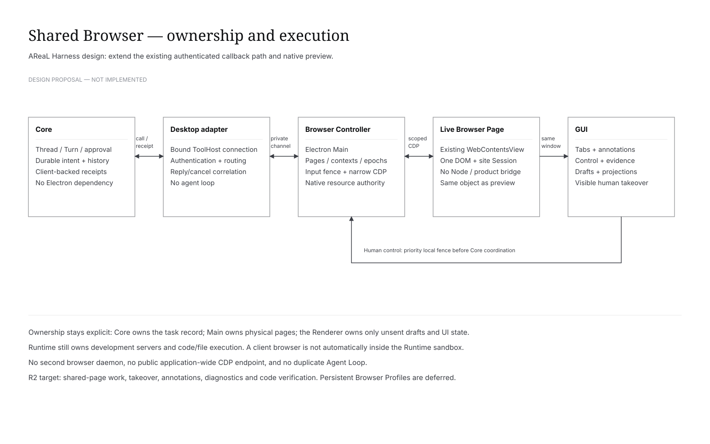

**中文** | [English](browser.en.md)

# Shared Browser：GUI 与 Harness 共同操作环境

本文件是设计规格，不表示功能已经实现。“Codex App-like”指这里定义的可验收浏览器协作体验，不承诺复刻私有实现、全部产品功能或视觉像素。术语见[领域词汇](../../GLOSSARY.md)，精确契约见[Browser API](../api/browser.md)。

## Problem Statement

用户已能在桌面预览 Web 页面，但 Agent 尚不能可靠地使用同一页面完成观察、交互、诊断、修改与验证。单独启动自动化浏览器会分裂用户状态；把 Electron 接口直接开放给模型又会绕开身份、权限、历史和取消边界。目标是把已有预览提升为受控共享 Browser，而非再造一套 Agent 系统。

## Solution

保留桌面原生浏览器，由唯一 Browser Controller 管理真实页面和输入控制。Core 延续任务、审批、工具意图和历史所有权；现有独立桌面适配器承接已绑定 Thread 的工具回调，并转交 Electron Main。GUI 呈现同一页面、当前控制者、操作进度、批注与验证证据。网页不能调用产品桥，也不能授予 Agent 权限。

### 交付范围与发布门

| 范围 | 交付 | 不能据此宣称 |
|---|---|---|
| R0 · 可行性门 | 用真实 Electron/Core fixture 验证同页读取、输入遮罩、截图坐标、CDP/DevTools 冲突 | 已支持生产或全部网站 |
| R1 · 安全共享 Browser | 同页认领、语义观察、截图、授权动作、人工接管/显式交还、旧 Thread 接入、多标签、临时上下文、恢复 | 完整开发者协作体验 |
| R2 · 开发体验完成 | R1 加区域/元素批注、诊断、响应式与 Canvas、服务/代码/验证闭环、临时样式试改、受控文件交接、短批量、跨入口观察及安装验收 | 所有 Codex 产品功能、持续无人值守或云浏览器 |
| 后续独立提案 | 后台独立浏览器、云端流式预览、任意宿主代码执行 | 本规格的隐含承诺 |

仅 R2 的发布验收全部通过后，才能称为本项目定义的“Codex-like 浏览器开发协作体验”。当前桌面 Profile 按明确产品要求供全部项目共享并持久保存；页面控制与任务归属仍隔离。每一阶段以功能开关和实际 capability 发布；没有实现的操作明确拒绝，不生成伪成功。

### 本项目体验覆盖矩阵

这是本项目的交付目标，不是外部产品的逐项能力清单。

| 用户可见能力 | 目标阶段 | 明确边界 |
|---|---|---|
| 已打开页面、Tab、地址、返回/前进、同页查看与操作 | R1 | 原生对象不替换；后台不抢焦点 |
| 授权、Agent动作指示、人工接管、私密输入、显式交还 | R1 | 人工阶段Agent不继续观察 |
| 持久登录、跨项目共享、页面控制按Thread隔离 | R1 | 数据操作仅由用户显式触发；独立userData隔离 |
| 失败/断线/缓存/崩溃恢复 | R1 | 保留UNKNOWN；URL恢复不等于内存状态恢复 |
| 区域和元素评论、草稿、发送到聊天 | R2 | 冻结区域截图优先；元素不可读时明确降级 |
| 临时样式/文字试改、撤销与发送修改意图 | R2 | 不是源码修改；清除覆盖后才能最终验证 |
| 服务启动/复用、代码diff、行为与视觉证据 | R2 | 复用Runtime；验证项必须可核查 |
| Console、network、人工DevTools | R2 | Agent只获受限诊断；不开放全应用CDP |
| 视口、缩放、Canvas、截图坐标 | R2 | 真实版本/平台测试；隐藏capture不保证 |
| 文件下载、上传交接 | R2 | 用户确认保存/选择文件；Agent不拿任意宿主路径 |
| CLI/其他入口观察同一任务 | R2 | 不抢Browser ToolHost；GUI不在时不造第二浏览器 |
| 全权限CDP、远程视频、独立后台浏览器 | 后续独立提案 | 不借“完整体验”隐含扩张本次范围 |

## User Stories

1. **US-01 · 打开已有页面（R1）**：作为用户，我希望 Agent 直接检查我已打开的页面，以免丢失表单、路由、滚动位置或临时登录状态。
2. **US-02 · 明确操作对象（R1）**：作为用户，我希望看到 Browser Page 所属项目、Thread 与控制者，以便发现操作错页。
3. **US-03 · 真实观察（R1）**：作为 Agent，我希望获得带范围、截断标记和有效 Ref 的语义观察，以便依据当前页面而非猜测选择元素。
4. **US-04 · 真实动作（R1）**：作为 Agent，我希望点击、填写、按键和等待得到分阶段回执，以便区分动作派发与目标达成。
5. **US-05 · 批准操作（R1）**：作为用户，我希望审批展示实际页面、目标和动作，而不是一段泛化工具名，以便做出知情授权。
6. **US-06 · 立即接管（R1）**：作为用户，我希望接管先在本机停止 Agent 新输入，再等待其他系统响应，以免网络或 Core 忙碌阻碍接管。
7. **US-07 · 隐私交接（R1）**：作为用户，我希望手工登录或输入敏感信息时停止 Agent 截图、DOM 和诊断采集，以免接管只是停止点击。
8. **US-08 · 显式交还（R1）**：作为用户，我希望只有显式继续才交还控制，Agent 先重看页面，以免使用接管前的旧观察。
9. **US-09 · 结果不明（R1）**：作为用户，我希望超时后保留结果不明状态，并先核对页面，以免重复提交或购买。
10. **US-10 · 旧聊天使用（R1）**：作为用户，我希望在空闲旧 Thread 启用 Browser，而不复制聊天或丢弃历史。
11. **US-11 · 多页任务（R1）**：作为用户，我希望新标签、跳转和弹窗仍属于同一浏览任务，以免产生无人管理的页面。
12. **US-12 · 临时登录（R1）**：作为用户，我希望同一 Browser Workspace 在本次桌面运行中复用临时登录，同时与其他 Thread 隔离。
13. **US-13 · 保住工作（R1）**：作为用户，我希望隐藏面板不关闭页面，执行中的页面不被缓存驱逐，以免后台动作丢失目标。
14. **US-14 · 故障可见（R1）**：作为用户，我希望页面崩溃或连接更换后看到不可用原因，并显式恢复，而不是悄悄操作替代页。
15. **US-15 · 局部截图反馈（R2）**：作为用户，我希望圈选画面、写评论并发送到当前 Thread，以便准确描述视觉问题。
16. **US-16 · 元素反馈（R2）**：作为用户，我希望点击选取具体元素，并附带可核查的语义与位置，以便 Agent 把反馈对应到页面。
17. **US-17 · 草稿安全（R2）**：作为用户，我希望切换聊天、中文输入、撤销批注或发送失败都不丢失草稿，也不把批注发给错误 Thread。
18. **US-18 · 开发诊断（R2）**：作为 Agent，我希望按需读取当前页面的 Console 与网络摘要，以便定位错误而不过量收集敏感内容。
19. **US-19 · 人工 DevTools（R2）**：作为开发者，我希望打开 DevTools 时明确暂停自动化，关闭后可安全恢复，以免 CDP 连接竞争。
20. **US-20 · 响应式验证（R2）**：作为用户，我希望切换视口、缩放和设备像素比时，截图、点选和坐标输入保持一致。
21. **US-21 · Canvas 操作（R2）**：作为 Agent，我希望在缺乏 DOM 语义时使用有来源截图和坐标输入，以便检查 Canvas 或游戏。
22. **US-22 · 开发服务闭环（R2）**：作为用户，我希望 Agent 启动或复用本地服务、打开对应页面、修改代码后验证，以免浏览器和代码链路割裂。
23. **US-23 · 验证证据（R2）**：作为用户，我希望从代码变更看到关联的前后截图与行为结果，以便区分声称完成与实际验证。
24. **US-24 · 样式试改（R2）**：作为用户，我希望先临时调整文字与样式、撤销或发送修改意图，以便探索效果，而不误以为代码已保存。
25. **US-25 · 下载与上传交接（R2）**：作为用户，我希望查看下载来源并确认保存；上传由我选择文件，以免 Agent 获得任意宿主路径访问。
26. **US-26 · 有界批量操作（R2）**：作为 Agent，我希望对已知页面执行短动作序列，逐步记录和检查控制权，以减少无用往返。
27. **US-27 · 跨入口观察（R2）**：作为用户，我希望 CLI 或其他观察入口查看同一任务，而不抢走 GUI 的 Browser ToolHost。
28. **US-28 · 退出语义（R2）**：作为用户，我希望退出 GUI 只释放其 Browser，而不停止其他 Core 任务，并准确显示受影响的浏览器调用。
29. **US-29 · 资源证据保护（R1）**：作为用户，我希望历史证据能按 Thread 授权回取，敏感字段不默认进入截图、日志或其他聊天。
30. **US-30 · 可用性和键盘操作（R2）**：作为用户，我希望控制状态、错误、授权和反馈流程能通过键盘及辅助技术使用，以便可靠完成工作。
31. **US-31 · 安装版一致（R2）**：作为用户，我希望安装版和开发版的 Browser 行为一致，不依赖开发机的 Playwright、全局 Chrome 或调试端口。
32. **US-32 · 清楚的范围（R2）**：作为用户，我希望知道哪些能力已经验收、哪些仍未开放，以免把阶段演示当作完整产品。

## Implementation Decisions

### 所有权和依赖

1. **Core** 是 Thread/Turn、Tool Intent、审批决定、历史和证据访问控制的唯一权威。浏览器结果使用现有 client 工具后端与 Blob 机制，不伪造 Runtime scope 或执行隔离。
2. **独立桌面适配器** 持有已注册的 ToolHost 连接，负责认证、路由、请求关联、取消及状态投影；不运行模型循环。
3. **Electron Main 的 Browser Controller** 持有 Browser Workspace、Page、临时上下文、原生连接、控制权栅栏和在途动作事实。它不持久化另一套会话历史。
4. **GUI Renderer** 持有布局和未发送草稿。页面 URL、标题和控制状态来自 Controller 事件；已提交批注与证据来自 Core。
5. **Runtime** 继续管理开发服务与代码/文件执行。共享浏览器是可信客户端宿主能力，不自动继承 Runtime 沙箱的安全保证。
6. 原生预览原地接管，不重新导航、不迁移 Cookie、不新建同 URL 页面。已有原生页面的身份检查和生命周期保护必须保留。

[可编辑架构图](diagrams/browser-architecture.drawio)

### 关键不变量

- **INV-01 同页**：人和 Agent 针对同一个 live Page；“相同 URL”不是同页证明。
- **INV-02 权威唯一**：任务与历史归 Core，原生资源归 Controller；投影不得反向写成权威。
- **INV-03 显式身份**：每次执行绑定已认证的部署、Thread、Host 和 Page 身份；模型自填的身份不授予权限。
- **INV-04 单写者**：同一 Browser Workspace 任一时刻只有一个人类或 Agent 控制租约；执行串行化，控制消息不排在长动作之后。
- **INV-05 接管优先**：本机先使旧控制代次失效；Core 断线也不能阻止人接管。人工控制期间 Agent 观察同样停止。
- **INV-06 不明不重放**：输入可能已派发但未确认时保留 UNKNOWN；新连接或旧回执不能重新执行。
- **INV-07 引用有范围**：Ref 绑定 Page、文档、Frame、节点身份；坐标还绑定截图和视口。失败不得按同名元素静默替代。
- **INV-08 权限不漂移**：审批绑定实际动作计划、站点、目标和控制代次，环境改变须重新准备；网页文字不能提升权限。
- **INV-09 临时隔离**：不同 Browser Workspace 不共享 Cookie/Storage；同一 Workspace 允许页面共享。临时上下文不是 OS/网络沙箱。
- **INV-10 生命周期诚实**：隐藏不销毁；销毁不保证页面状态恢复；GUI 退出不结束无关 Core 任务。
- **INV-11 证据可信**：动作执行不等于业务成功；验证保存检查、观察和代码版本关联，无法验证明确标为未验证。
- **INV-12 能力真实**：只公布握手成功且可用的能力；CLI 无 GUI 时不偷偷启动第二浏览器。

### 工具、授权与恢复

工具使用固定、版本化的 Browser Dispatcher 和运行时能力说明，精确输入按对应操作 schema 验证；不允许把未知参数当脚本执行。读/动作两条路径都检查实际资源与控制代次。Core 对动作先记录意图、请求宿主只读 prepare、保存实际计划并审批，然后才派发 execute。宿主在派发前再次验证授权与目标；用户输入直接走人工控制路径，不伪装成 Agent 调用。

新 Thread 在创建时登记 Browser Dispatcher。旧 Thread 的工具表不能直接改写；使用限定的、空闲时追加机制，保留已存在定义及历史，详见[ADR-0007](../adr/0007-browser-tool-compatibility.md)。版本不支持时禁用入口而不是复制会话或修改存储文件。

确认失败、未执行、已派发不明分别映射现有 Core 语义。既有 UNKNOWN 检查确认只增加核对记录，不改变原执行结果。人工“继续”是新授权和显式续轮，不是隐式重试。

### Browser 体验

同页控制、Live 状态、元素/区域评论、临时样式和代码修改分别标识。原生 WebContentsView 不因参考项目采用另一种 View 而迁移。原生叠层若不能可靠实现，则区域批注在带时间与视口元信息的冻结截图上完成；输入屏障和接管能力不得退化。详细交互和状态见[UX 规格](browser-ux.md)。

结构化批量动作采用受限序列，每一步有可撤销准入和独立回执；不引入任意 Node.js/JS Runner。使用成熟公开的浏览器操作语义和测试能力，但不宣称完整 Playwright API 兼容。

## Testing Decisions

以现有真实桌面端到端测试形态为主：真实 Electron、真实 Core 与 Runtime、确定性模型、临时站点和隔离用户数据。测试经用户入口或公开 Core API 驱动，并以页面/服务端事实和 Core 历史断言。Native Controller 的少量状态机测试用于穷尽代次、重复回调和拒绝边界；不为每一层新建一套相同 mock 流程。

Browser 主要验收切口是“确定性模型发工具 → 同一真实原生页面变化 → Core 记录结果 → GUI 呈现与人接管”。不通过直接调用私有 Controller 来冒充端到端。安全、取消、错误和大媒体与 happy path 一起交付。完整场景 ID、发布门和证据见[测试规格](../development/browser-testing.md)。

## Out of Scope

Chrome 扩展、全应用 raw CDP、任意宿主 JavaScript、OS Computer Use、云浏览器、完整远程画面串流、多 Agent 同页并发写、CAPTCHA 绕过、自动支付/不可逆敏感业务动作，以及全站点/全操作系统兼容承诺不在本规格中。对高风险外部提交采用人类接管。真实账号登录兼容性独立验证。

## Further Notes

Core/适配器/Main/Renderer 的所有权边界已接入；操作可用性以 Host 能力发现和公开 API 的实现限制为准。共享持久 Profile 与显式 Chrome 导入遵循 Browser API；云浏览器仍不开放。来源证据、基线 SHA、运行结果与待验证项属于各自验收记录，不混入长期规范。外部网页只作为不可信数据；发布 GitHub Issues、PR 或线上配置需要对应授权。
